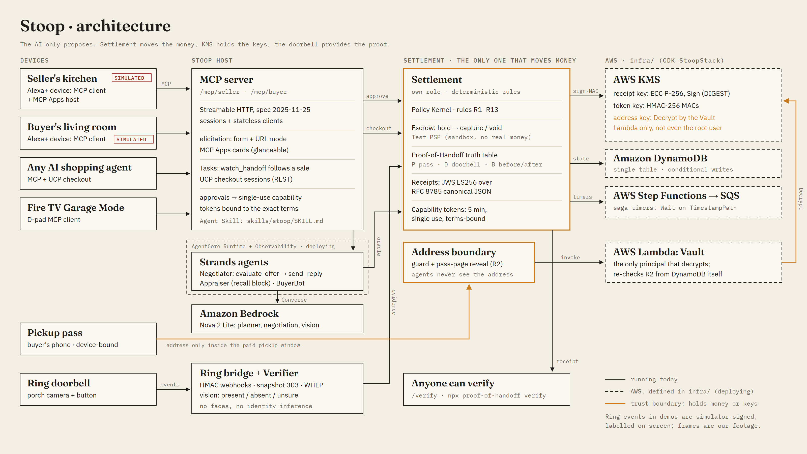

# Stoop

**Sell anything without meeting anyone. Money moves only when your porch camera sees it go.**

**Try it: https://d29kyjvj1jibpu.cloudfront.net** Open a shop, photograph something you'd sell, send the link to a friend, and use an old phone or a laptop as the porch camera. No sign-up; test payments only, nothing is ever charged.

**Judges:** the same app plus the Alexa+ device demo (seller and buyer side by side) at https://d2h8mmod981k0j.cloudfront.net/demo

**Watch a whole sale in 99 seconds:** the walkthrough video plays on the home page (`apps/web/public/demo.mp4`, recorded by `services/stack/e2e/record-walkthrough.ts`).

Stoop is an **Alexa+ add-on** (MCP server + MCP Apps cards) and a **Ring Appstore app**.

- You tell your assistant *"Sell the stroller and the bike. Don't go below $90 on the stroller."*
- Stoop prices and lists them, then negotiates with buyers, including buyers' own AI assistants. It never knows or reveals your minimum.
- The buyer pays through an Alexa+-style checkout. **The money is held, not charged.**
- The buyer picks the item up off your porch. **Your Ring doorbell provides the proof of handoff**: check-in, doorbell event, item there before and gone after. Only then is the money released, with a signed receipt anyone can verify.

**The AI never holds the keys.** Money, your address and receipts are controlled by a separate Settlement service under deterministic rules. In a 300-attack red team on Amazon Bedrock (Nova 2 Lite), a naive agent with the address in its prompt leaked it **57 times (19%)**; Stoop's agent leaked it **0 times**, because it never had it ([`evals/REPORT.md`](evals/REPORT.md)).



## Run it (Windows, macOS or Linux; Node 22)

```bash
git clone https://github.com/hash066/stoop.git
cd stoop
corepack enable     # provides the pinned pnpm (11.0.8)
pnpm install
pnpm demo
```

| Open | What |
|---|---|
| http://localhost:5180/?role=seller | Simulated Alexa+ device, seller's kitchen |
| http://localhost:5180/?role=buyer | Simulated Alexa+ device, buyer's living room |
| http://localhost:5183 | Mission control: events, Policy Kernel decisions, scenarios, Ring live view |
| pickup pass | opened by the buyer device ("send my pickup pass"); one-time code in the Ops email outbox |

Follow [`docs/DEMO_SCRIPT.md`](docs/DEMO_SCRIPT.md) for the 3-minute flow. Everything runs offline by default. `LLM_MODE=bedrock` switches agents and vision to Amazon Bedrock (see [`.env.example`](.env.example)).

### Hosted mode: what testers and judges get

**The Stoop web app** (`apps/web`) is the product with no simulation in the flow:

- **Seller:** opens a shop with their real pickup address (encrypted; buyers see it only on their pass, during their window) and uploads photos. Bedrock names and prices each one; an AI estimate is labelled as one. They list with a private lowest price and share the link.
- **Buyer:** on another device, asks and haggles with the seller's assistant (typed or spoken, through the same MCP tools and planner an Alexa+ device uses). They pay (held, not charged) and open the pickup pass on their phone.
- **Porch camera:** any phone or laptop running the camera page. It takes the before and after photos, and during a pickup its motion detector asks Bedrock vision whether a person is at the door (counted, never identified).
- **Handoff:** the buyer taps I'm Here, the camera sees someone and then the item gone, and the money moves with a signed receipt. If the camera can't tell, both people confirm.

Each shop is its own private world. The Alexa+ device tour (seeded demo household, labelled simulator) lives at `/demo`.

```bash
pnpm build:web
PORT=8080 ADMIN_KEY=local pnpm serve       # http://localhost:8080 (web app), /demo (device tour)
pnpm --filter @stoop/stack e2e             # seller, buyer phone and camera phone in three Chrome profiles, end to end
pnpm tour http://localhost:8080 local      # drives the device tour in Chrome
```

Docker image: `Dockerfile`. AWS deployment (CloudFront + one instance, a public site with offline agents and a judge site on Bedrock): [`docs/DEPLOY.md`](docs/DEPLOY.md).

## Amazon SDKs and protocols, and where they are used

| SDK or protocol | Where | Status |
|---|---|---|
| **MCP** (`@modelcontextprotocol/sdk` 1.32.1, spec 2025-11-25): Streamable HTTP, sessions, structured output, form + URL **elicitation**, experimental **Tasks** | Server: `services/mcp-server`. Clients: the web app (`apps/web/src/api.ts`, approvals arrive as elicitation mid-call), the Alexa+ device simulator (`apps/alexa-sim`) | Live on both sites |
| **MCP Apps** (`@modelcontextprotocol/ext-apps`) | Cards in `packages/ui-cards`, hosted by the device simulator | Live (judges' `/demo`) |
| **Alexa+ add-on checkout contract (UCP 2026-04-08)** | `services/settlement/src/ucp.ts`; R13 purchase rules (breakdown, explicit yes, 4-digit code over $100) | Live |
| **Alexa Skills Kit SDK** (`ask-sdk-core`, `ask-sdk-express-adapter` request-signature and timestamp verification) | `services/stack/src/alexa.ts`, endpoint `POST /alexa`; skill package in `alexa/` (invocation "stoop shop"): sellers hear and accept offers, buyers find, offer and pay with their purchase code | Deployed (development stage) and checked through Amazon's Alexa simulator against the live site |
| **Agent Skills** | `skills/stoop/SKILL.md` (the planner's instructions) | Live |
| **Strands Agents SDK** (`@strands-agents/sdk`) | The negotiating agent, `services/agents/src/negotiator.ts` | Live on Bedrock |
| **Amazon Bedrock** (Nova 2 Lite via `@aws-sdk/client-bedrock-runtime`) | Planner, negotiator, photo identification and pricing, porch-camera vision | Live, under daily call caps |
| **AWS SDK v3**: KMS, DynamoDB, Step Functions, SQS, Lambda | `services/settlement/src/aws/`, deployed by `infra/` (CDK) | Deployed and verified end to end; the hosted sites still keep shops in memory |
| **AWS CDK** | `infra/` (StoopStack, StoopHostStack, $30 budget with stop actions) | Deployed |
| **Ring Partner API** | `services/ring-bridge` (snapshots, clips, WHEP, signed webhooks) | Checked with a Playground token; no Ring hardware here, so shops use a phone or laptop as the porch camera |
| **Kiro** | `.kiro/specs/` (Policy Kernel spec-first) | Done |
| **Bedrock AgentCore Runtime** (`@aws-sdk/client-bedrock-agentcore`, CDK `CfnRuntime`, Node 22 code deployment) | The negotiating agent runs on AgentCore (`services/negotiator-runtime`, `infra/lib/agent-stack.ts`); shops call it per turn and it reaches them only through a one-time negotiation port (`services/stack/src/agentcore.ts`); CloudWatch logs per turn | Live on both sites |

## What's real and what's simulated

| Real | Simulated (by hackathon rule or necessity), always labelled |
|---|---|
| MCP servers (spec 2025-11-25, Streamable HTTP, sessions, form + URL elicitation, structured output, MCP Apps) | The Alexa+ client: add-on tooling is partner-only, so we built a device simulator that is a **real MCP client and MCP Apps host** |
| UCP checkout endpoints matching the Alexa+ add-on contract (2026-04-08) | Payment processor: `SandboxPSP` with Stripe manual-capture semantics ("Test PSP") |
| The web app's porch camera: a real phone or laptop camera, Bedrock vision for item-there/item-gone and person counts (origin `porchcam` on every frame and receipt) | |
| Ring Partner API client (snapshots, clips, WHEP live view), HMAC webhook ingest. Checked against the Ring API with a Developer Playground token (Oct 18): auth and device listing work; image download needs a device that has recordings | Ring events from our signed simulator (the Playground doesn't deliver webhooks; a judge confirmed own simulators are fine), plus our own labelled porch footage |
| Strands agents, the Policy Kernel, KMS-style tokens and ES256 receipts | Offline `ScriptedModel` and footage-label vision until Bedrock access is active |

## Tests and evals

```bash
pnpm test           # 183 tests: policy (property-based), receipts, settlement, UCP, Ring, ring-sim, verifier, agents, MCP end-to-end (incl. Tasks + my_items)
pnpm eval:redteam   # 300 adversarial conversations + 200 benign buyers -> evals/REPORT.md
pnpm eval:poh       # proof-of-handoff confusion matrix -> evals/POH_REPORT.md
```

**End-to-end:**
- The golden path runs through two real MCP clients: sweep → appraise → list → mandate → haggle → approve → UCP checkout → pass → doorbell → VERIFIED → paid.
- The scrutiny path covers:
  - 401/403/404 protocol hardening
  - an Alexa-style session-less client
  - the > $100 voice code
  - scam blocking and the two-buyer race
  - piracy, no-show, item still there, camera offline, and webhook replay
  - offer flooding (rate limited before any model call)
  - MCP Tasks: `watch_handoff` follows a sale to CLOSED, stays private to its owner, and can be cancelled
- **Alexa+ design rules as a test** (`services/stack/test/design-rules.test.ts`): every spoken line and approval prompt in a full sale (33 lines) is under 30 seconds (longest: 56 words), offers at most 5 options, and never speaks an id, JSON or a URL.

**Browser QA and demo recording** (needs `pnpm demo` running and Google Chrome; uses `playwright-core`, which never downloads a browser):

```bash
pnpm qa       # every judged surface at 1280x800 and 390 px: console/HTTP errors + screenshots
pnpm record   # the golden path as one .webm clip per surface, for the video
```

**Simulated Ring events from the command line** (local or deployed; always labelled simulator-signed):

```bash
pnpm ring-sim event button
pnpm ring-sim replay
pnpm ring-sim scenario golden
```

## Fire TV (Garage Mode)

`apps/firetv` is **Garage Mode**: the household's sellable things on the big screen. Pick items with
the remote's D-pad, press **List selected**, approve on screen, and Stoop lists them — the footer
shows the live sale line through to "Sold". It's built on Amazon's
[`react-native-multi-tv-app-sample`](https://github.com/AmazonAppDev/react-native-multi-tv-app-sample)
(MIT-0) and is a **real stateless MCP client** to the same stack (it holds no money or address keys;
it only proposes). It is a **separate Yarn 4 workspace**, so use `corepack yarn`:

```bash
pnpm --filter @stoop/stack start      # the stack on :8787
cd apps/firetv && corepack yarn install && corepack yarn dev:web   # open http://localhost:8082
```

See [`apps/firetv/README.md`](apps/firetv/README.md) for details and the Android TV build.

## Docs

- [`docs/ARCHITECTURE.md`](docs/ARCHITECTURE.md): components, protocols, truth table, local-vs-AWS mapping
- [`docs/AGENTS.md`](docs/AGENTS.md): agents, rules R1–R13, guidance for coding agents
- [`skills/stoop/SKILL.md`](skills/stoop/SKILL.md): the Agent Skill for assistants using Stoop
- [`docs/AWS_BUILDER.md`](docs/AWS_BUILDER.md): AWS services, honest status per row
- [`docs/PRODUCT_FEEDBACK.md`](docs/PRODUCT_FEEDBACK.md) · [`docs/FRICTION_LOG.md`](docs/FRICTION_LOG.md)
- [`docs/RING_CERT_NOTES.md`](docs/RING_CERT_NOTES.md) · [`docs/AI_DISCLOSURE.md`](docs/AI_DISCLOSURE.md) · [`docs/PLAN.md`](docs/PLAN.md)
- Open source:
  - [`packages/proof-of-handoff`](packages/proof-of-handoff), published on npm as [`proof-of-handoff`](https://www.npmjs.com/package/proof-of-handoff): verify any receipt with `npx proof-of-handoff verify receipt.jws --jwks jwks.json`
  - [`oss/ring-api-helloworld`](oss/ring-api-helloworld): a media-helpers contribution to Amazon's Ring starter, open upstream as [AmazonAppDev/ring-api-helloworld#36](https://github.com/AmazonAppDev/ring-api-helloworld/pull/36) (issue [#35](https://github.com/AmazonAppDev/ring-api-helloworld/issues/35))

## Repo layout

```
packages/  shared · policy · proof-of-handoff · ui-cards
services/  settlement · ring-bridge · verifier · agents · mcp-server · stack
tools/     ring-sim (simulator-signed Ring webhooks)
apps/      alexa-sim · pass · ops · firetv (Garage Mode, Yarn 4)
evals/     red team + proof-of-handoff
oss/       ring-api-helloworld contribution
skills/    stoop/SKILL.md
```

## License

MIT
