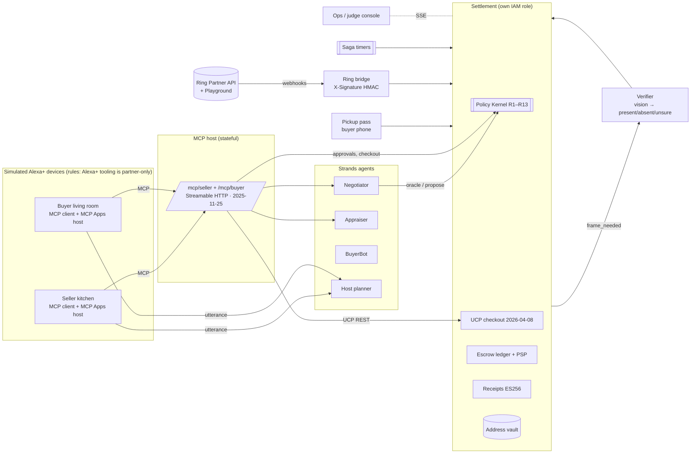
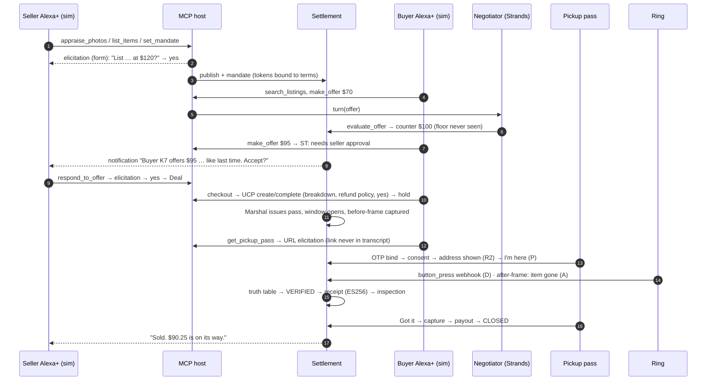

# Stoop architecture

> **Sell anything without meeting anyone. Money moves only when your doorbell sees it go.**

## One rule above all

The AI never holds the keys. Agents and the MCP host can only **propose**. Only the **Settlement** service can:
- move money
- reveal the address
- accept a deal
- sign a receipt

It does so only under deterministic rules in `packages/policy`, and usually only with a single-use capability token bound to the exact terms a human approved.

| Guarantee | How it's enforced |
|---|---|
| Address never leaks through an agent | The address is encrypted in Settlement's vault (KMS in AWS, decrypt grant only to Settlement). It's revealed only to the paying buyer's device-bound pass, inside the window (R2). Outbound agent text is also checked against address fragments |
| The floor price is never disclosed | Negotiator agents see oracle answers only: `acceptable?` and `suggested counter`. Counters are floor-shielded and monotone (R5) |
| No payment without proof | Capture requires a VERIFIED Proof-of-Handoff plus buyer "Got it" or a 2-hour inspection; or dual confirmation (≤ $150); or a dispute verdict (R3) |
| A "yes" can't be replayed or bent | Capability tokens are MAC'd (KMS GenerateMac in AWS), expire in 5 minutes, are single-use, and are bound to `termsHash` = SHA-256 over the RFC 8785 canonical terms shown (R4) |

## Components

| Module | Path | What it does |
|---|---|---|
| Shared schemas | `packages/shared` | zod types for every entity and event |
| Policy Kernel | `packages/policy` | Rules R2–R13 `decide()`, the deal saga state machine, the Proof-of-Handoff truth table, capability tokens, JCS terms hashing, scam/injection/leak guards. Pure, ~100% covered, property-tested |
| Proof of Handoff (OSS) | `packages/proof-of-handoff` | Receipt schema, JCS + JWS ES256 sign/verify, the KMS DER→raw converter, the `poh verify` CLI |
| Settlement | `services/settlement` | Listings, approvals, negotiation oracle, deals (atomic one-per-listing), UCP checkout, escrow, the device-bound pass, evidence, receipts, capture/void, scheduled jobs |
| Ring bridge | `services/ring-bridge` | Webhook HMAC verify + v1.1 normalization, the Partner API client (snapshot 303, clip 416/425, WHEP, 429/503), frame sources |
| Verifier | `services/verifier` | `frame_needed` → frame → vision (categorical, no identity) → `recordFrame` |
| Agents | `services/agents` | Strands Negotiator with guarded tools, Appraiser (vision + comps + CPSC rules), BuyerBot personas, host planner, and a ScriptedModel for offline runs |
| MCP server | `services/mcp-server` | Seller and buyer tools, elicitation (form + URL), approval fallback, MCP Apps cards, sessions plus a stateless path |
| Stack | `services/stack` | Local composition, the Marshal (issues passes), notifications, Ops SSE, pass API, `/verify`, simulator, planner endpoint, EXIF stripping |
| Cards | `packages/ui-cards` | Six single-file MCP Apps on the official ext-apps `App` class |
| Apps | `apps/alexa-sim`, `apps/pass`, `apps/ops` | Alexa+ device simulator (seller/buyer), buyer pickup pass, mission control |

## The golden path

## Proof-of-Handoff truth table (`packages/policy/src/handoff.ts`)

Signals:
- **P:** the device-bound pass checked in inside the window.
- **D:** a Ring `button_press`, or `motion_detected` other than vehicle/package/other, within ±3 minutes of P.
- **B:** the before-frame shows the item.
- **A:** the after-frame verdict: present, absent or unsure.

Rows are checked top-down:

| # | Condition | Verdict |
|---|---|---|
| 1 | camera offline / E2EE / unavailable | DEGRADED → dual confirm, $150 cap |
| 2 | no after-frame | PENDING |
| 3 | after = unsure | RETRY ×3, then REVIEW |
| 4 | after = present | STILL_THERE if P, else PENDING |
| 5 | after = absent, B ≠ present | REVIEW (can't attribute) |
| 6 | after = absent, no P | PIRACY_SUSPECTED (never captured, hold voided, alert) |
| 7 | after = absent, P, no D | PENDING until check-in + 3 min (webhooks lag), then REVIEW |
| 8 | after = absent, P, D, B | **VERIFIED** → signed receipt |

## Protocols

- **MCP 2025-11-25, Streamable HTTP**
  - Session per `initialize`.
  - A stateless path for clients that send no session id; Amazon's Alexa+ client example does this, with protocol 2025-03-26.
  - Bearer auth with an RFC 9728 `resource_metadata` challenge, and Origin validation.
  - `GET` → 405 (no standalone stream).
  - Elicitation: form for approvals; URL for the pickup pass and anything sensitive.
  - Tools with `outputSchema`, `structuredContent`, and `_meta.ui.resourceUri` on both the definition and the result.
- **MCP Apps 2026-01-26**
  - `ui://stoop/<card>@<hash>`, `text/html;profile=mcp-app`.
  - The host renders through a cross-origin sandbox proxy, with default-deny CSP.
- **UCP 2026-04-08**, matching the Alexa+ add-on checkout contract
  - `POST/GET/PUT /checkout-sessions`, `…/complete`, `…/cancel`, `/.well-known/ucp`.
  - Required `UCP-Agent`, `Idempotency-Key` (24 h; 409 on conflict) and `Request-Id`; responses set `Cache-Control: no-store`.
  - All six statuses are implemented.
- **Ring Partner API**
  - `X-Signature: sha256=` over the raw body; dedupe on `meta.request_id`; ack within 5 s.
  - Snapshot 303 → pre-signed URL; clip retries on 416/425; WHEP live view; RTSP.

## Local vs AWS

| Concern | Local (now) | AWS (deploy plan, us-east-1) |
|---|---|---|
| MCP host | Hono in-process | AgentCore Runtime (stateful MCP) or EC2 + Caddy (decided by spike) |
| Agents | Strands + ScriptedModel | Strands + BedrockModel (Nova 2 Lite / Claude Sonnet 4.6) on AgentCore Runtime |
| Settlement + UCP | In-process module | Lambda with its own IAM role, behind API Gateway |
| Store | MemoryStore (conditional writes) | DynamoDB single table (`TransactWriteItems`) |
| Address vault | AES-256-GCM local key | KMS key; Decrypt granted only to Settlement |
| Capability tokens | HMAC local key | KMS `GenerateMac` / `VerifyMac` |
| Receipts | P-256 local key (`.data/`, gitignored) | KMS `ECC_NIST_P256`, `MessageType=DIGEST`, DER→raw |
| Saga timers | TickScheduler | Step Functions Standard, Wait + `TimestampPath` |
| Events | EventBus + SSE | EventBridge + API Gateway WebSockets |
| Vision | Footage labels (offline) | Bedrock Converse image blocks |
| Seller memory | In-memory | AgentCore Memory (user-preference strategy) |
| Payments | SandboxPSP (Stripe manual-capture semantics) | Same adapter, or Stripe test on a US platform account |
